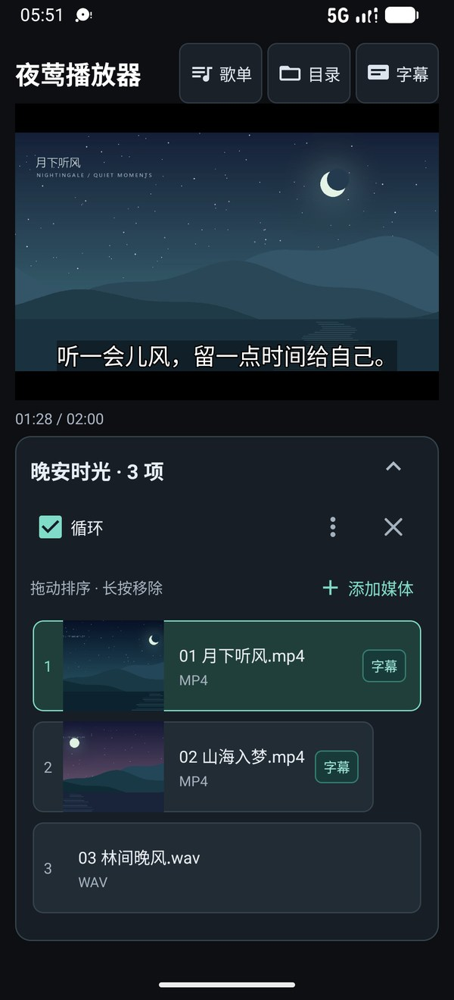
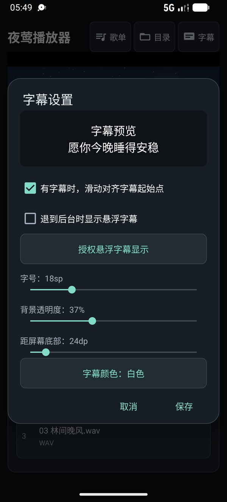
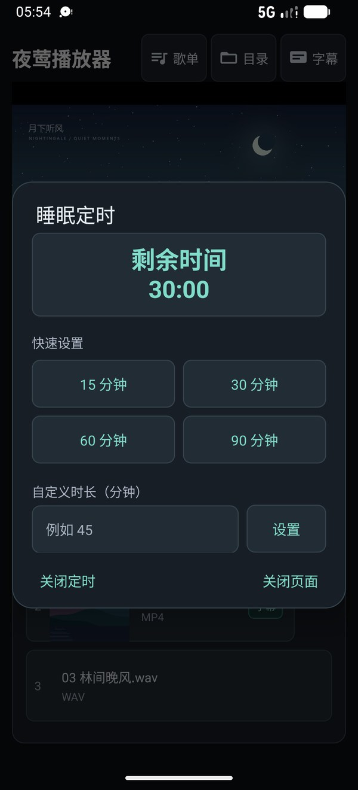
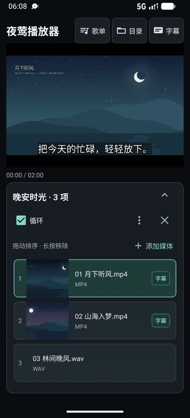
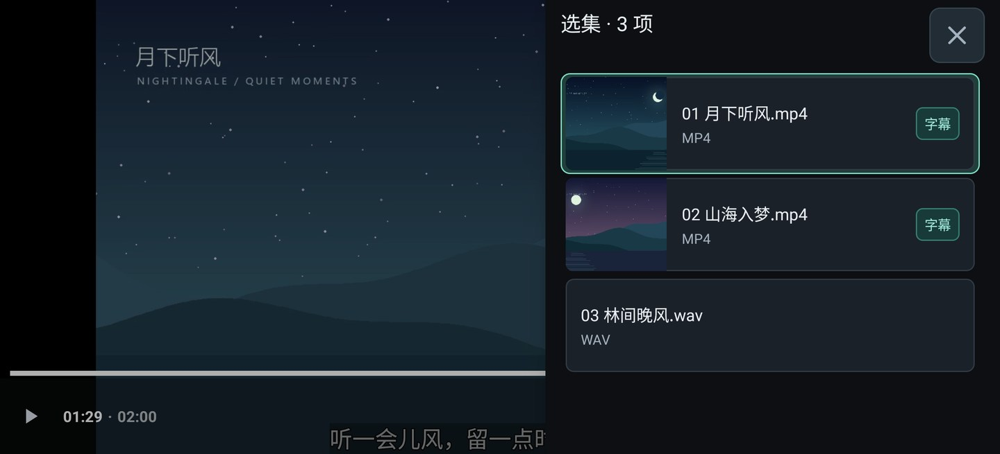

  

<h1 align="center">夜莺播放器</h1>

把喜欢的声音留在身边。精听、循环，或听着入睡。

  <a href="https://github.com/Sunny-Jiang-chs/NightingalePlayer/releases/latest"><b>下载 Android 安装包</b></a>
  · <a href="#界面与操作演示">看看怎么用</a>
  · <a href="docs/USAGE.md">使用指南</a>

Android 8.0 及以上 · 本地 MP4 / MP3 / WAV · VTT / LRC 字幕

## 用夜莺做什么

| 功能 | 用起来是什么样 |
| --- | --- |
| **📂 打开就听** | 选择本地目录，点一下播放。视频有缩略图，匹配到字幕一眼就能看到。 |
| **🎧字幕自动匹配** | 自动匹配字幕和歌词；开启字幕定位后，滑动就能对齐一句话的开头。 |
| **📋播放序列配置** | 跨目录添加、拖动排序、长按移除，修改自动保存；一首反复听，一组接着听。 |
| **🗂️ 支持访问隐藏目录** | 隐藏文件夹里的视频、字幕也能浏览和播放 ，不用先挪出来        |
| **🌙 支持定时结束** | 设置睡眠定时，到点自动暂停；倍速、音量和字幕样式随手调整。 |
| 📱**后台播放字幕悬浮** | 支持后台播放、播放进度恢复，还能开启悬浮字幕。 |

## 界面与操作演示

<table>
  <tr>
    <th>播放与歌单</th>
    <th>字幕随心调整</th>
    <th>睡眠定时</th>
  </tr>
  <tr>
    <td></td>
    <td></td>
    <td></td>
  </tr>
</table>

**歌单操作** — 拖动排序、长按进入移除模式，再打开保存的歌单和字幕设置。

  

<a href="tmp/readme-demo/published/playlist-demo.mp4">查看歌单操作视频 · 17 秒</a>

**全屏选集** — 画面保持全屏，展开右侧预览，点一下切到下一段。

  

<a href="tmp/readme-demo/published/fullscreen-demo.mp4">查看全屏切换视频 · 6 秒</a>

## 三步开始

1. **安装并选择目录**：从 [Releases](https://github.com/Sunny-Jiang-chs/NightingalePlayer/releases/latest) 下载 APK，打开应用，点击顶部“目录”选择媒体文件夹。
2. **点开喜欢的内容**：点击卡片播放；同名 VTT / LRC 放在媒体旁边即可自动匹配，点击“字幕”调整显示样式。
3. **按自己的方式听**：从“歌单”新建或打开列表，开启循环；睡前在播放器设置中设好定时。

只想直接播放时，选好目录就能用。需要访问隐藏文件夹，可在“目录”中选择“浏览全部目录（含隐藏）”。

## 进一步了解

- [使用指南](docs/USAGE.md)：字幕命名、歌单操作、全屏选集、定时与后台字幕。
- [开发与构建](docs/DEVELOPMENT.md)：代码架构、播放优化、构建命令与自动检查。
- [调试说明](调试说明.md)：运行、安装与测试媒体同步。
- [版本与下载](https://github.com/Sunny-Jiang-chs/NightingalePlayer/releases)：安装包与更新记录。
