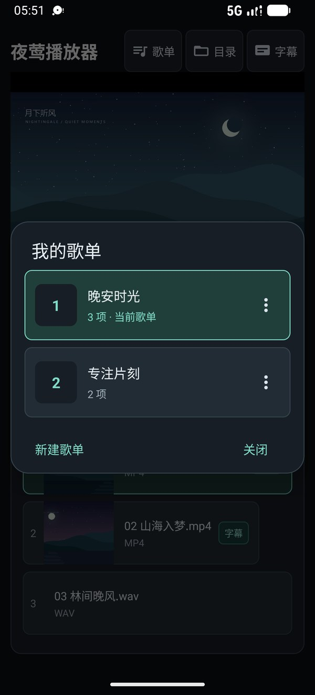

# 使用指南

[返回首页](../README.md) · [开发与构建](DEVELOPMENT.md)

## 目录与本地播放

点击顶部“目录”，选择存放媒体的文件夹，然后点媒体卡片播放。支持 MP4 视频与 MP3、WAV 音频；视频卡片显示缩略图，匹配到字幕时显示“字幕”标记。媒体分组可折叠。

普通目录使用系统目录选择器授权。需要访问 `.movie` 等点号开头的隐藏文件夹时，选择“浏览全部目录（含隐藏）”，按提示授予“所有文件访问”，再使用应用内目录浏览器选择目录。

## 字幕与歌词

VTT 字幕或 LRC 歌词与媒体放在同一个目录，即可自动匹配。支持 `video.vtt`、`video.wav.vtt`、`video.zh.vtt` 等命名；LRC 支持时间偏移与一行多个时间戳。

```text
我的音频/
├── 晚安.mp4
├── 晚安.vtt
├── 林间.wav
└── 林间.lrc
```

点击顶部“字幕”调整字号、颜色与底部距离，设置时可实时预览。字幕使用透明背景，保留文字描边或阴影。开启“有字幕时，滑动对齐字幕起始点”后，短距离左滑选择上一句，右滑选择下一句；继续拖动可以跨越多句。处于首句时左滑回到首句起点。


## 播放与全屏选集

点一下画面显示控制栏；左右滑动画面可快进或回退。控制栏提供播放、暂停、进度、音量、全屏与设置。设置中可调整画面适配、裁剪、拉伸、双指缩放、0.5x–2x 倍速和原声／+6／+12 dB 增益。

目录播放时，打开设置 → “循环播放”，可单选“单集循环”“列表循环”或“不循环”，默认不循环。单集循环只重复当前媒体，无需创建歌单；列表循环按当前目录播放队列依次播放，队尾结束后回到队头；不循环则依次播放到队尾停止。切换模式立即生效，保留当前媒体、进度与播放／暂停状态。所选模式会记忆，并与歌单的循环开关分别保存。

全屏后，设置旁会出现“选集”。点开右侧预览列表，点击媒体即可切换并继续保持全屏；播放歌单时显示当前歌单，播放目录时显示正在播放的目录队列。仅浏览其他目录或编辑歌单不会替换选集。面板避让系统栏和屏幕开孔，支持滚动浏览，点击关闭、面板外或返回键收起。

## 歌单

设置列表后，播放屏幕下方依次显示“播放列表”和“当前目录内容”，MP4 和音频作为当前目录的子分组；未设置列表时，直接显示 MP4、音频分组，不显示这两层总标题或歌单操作行。预览仍可折叠收起，目录区域不再常驻显示操作提示和目录路径。

“播放列表”标题下方操作行的“循环”开关独立控制是否循环，开启后，列表只有一项时重复播放这一项，多项时按编号依次播放并回到第一项；关闭后，按列表顺序播放到末项结束。切换循环选项立即生效并记忆，不改变当前媒体、进度或播放/暂停状态。播放器设置菜单不再放置播放列表入口；播放歌单时，循环仍在歌单上调整。

主页列表和添加媒体窗口复用媒体库现有的 MP4 缩略图与字幕标记，音频显示文件名和格式。列表超出可见区域时，右侧显示独立滚动条，拖动滑块或点按轨道即可上下浏览，不改变顺序；较短列表不显示滚动条。直接按住主页卡片任意位置上下拖动即可排序；长按不动进入移除模式，所有卡片右上角一起显示 ×，可连续点击剔除条目。点任意卡片中间收起全部 ×，恢复播放和拖动操作。排序、移除立即应用并保存，无需进入编辑窗口或另点保存。移除只影响列表，不删除媒体文件；当前媒体仍在应用后的播放队列中时保留进度与播放/暂停状态，不在新队列时停在第一项，等待手动播放。

单击目录媒体卡片直接播放；播放列表处于打开状态时，双击卡片只把媒体追加到列表末尾，空歌单也支持加入第一项，不中断当前播放。关闭播放列表后，目录卡片恢复普通播放操作。目录播放队列与自定义播放列表分别保存，编辑播放列表不会替换正在播放的目录队列；点击播放列表中的卡片才切回列表播放。“添加媒体”位于播放列表展开内容内、媒体卡片上方；尚无列表时，从顶部“歌单”新建或打开歌单。选择窗口只显示本目录中尚未加入列表的媒体，确认后追加，取消不改动列表。

播放列表在整个应用中保存，允许把不同目录的媒体混合排列。切换目录只更新“当前目录内容”，保留列表和正在播放的队列；应用重启也会恢复列表及其字幕信息。

顶部“歌单”与“目录”“字幕”同排，统一提供新建和读取入口。打开的“我的歌单”窗口列出本机已保存歌单的名称、媒体项数和当前标记，点选即可打开；每行的 ⋮ 可重命名或删除。播放列表操作行的 ⋮ 提供“保存为歌单”或“另存为新歌单”。打开或创建歌单后，标题直接显示“歌单名 · X 项”，媒体增删、排序和循环设置自动更新当前歌单。歌单使用独立标识，同名歌单也不会意外覆盖；旧版命名歌单会保留并自动迁移。空歌单可以继续添加媒体。

标题将歌单名与项数合为一行，长名称中间省略，折叠箭头位于最右侧；未命名时显示“播放列表 · X 项”。循环、更多操作和清空放在下方独立操作行。“添加媒体”与拖动、长按提示共用一行，使用轻量图标与文字按钮，随播放列表一起收起；当前目录不再显示歌单操作入口。× 清空当前播放列表，并临时显示“撤销”；在主界面继续完成 3 次触摸操作或等待 10 秒后，提示自动淡出。清空保留当前媒体和进度，解除已保存歌单的关联，不清空或删除该歌单。新建、打开或恢复列表会结束上一次清空的撤销提示。删除歌单需确认，只移除歌单记录，不删除媒体文件；删除当前歌单时，当前队列仍可使用。



## 睡眠定时

在播放器设置中打开“睡眠定时”，可选择 15、30、60、90 分钟，或输入 1–1440 分钟。面板显示剩余时间，退到后台后仍会倒计时；时间到自动暂停并停止后台播放服务。

## 后台播放与悬浮字幕

应用中点击“字幕”，打开“退到后台时显示悬浮字幕”，再点击“授权悬浮字幕显示”并允许“显示在其他应用上层”。保存后，播放带 VTT 的媒体并退到后台；只有当前 cue 有文字时才会显示悬浮字幕。字幕设置也会同步作用于前台视频字幕。

应用支持后台播放，并保存媒体、播放位置和播放状态，方便再次进入时继续收听。

## 本地数据

应用在私有存储中保存目录授权、歌单、播放位置、音量、倍速、增益、画面、字幕和定时设置；LRC 转换后的字幕保存在应用缓存中。移除歌单条目、清空列表或删除歌单记录都不会删除原媒体文件。
